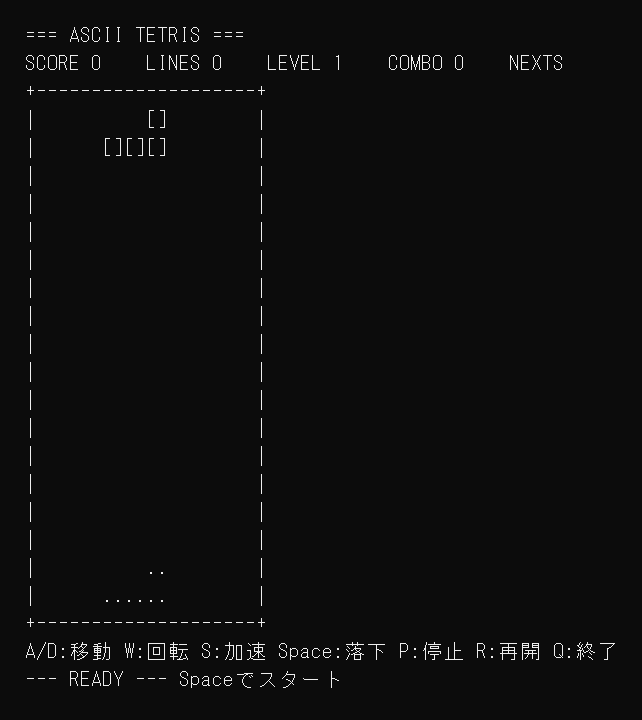

# ゲームタイトル

テトリス

## ゲームの概要

Pythonの標準ライブラリで動作する、ターミナル表示のテトリスです。
横10マス・縦18マスの盤面で、7種類のブロックを移動・回転させ、横一列をそろえて消します。新しいブロックを出せなくなるとゲームオーバーです。

画面にはスコア、消去ライン数、レベル、コンボ数、次のブロックの種類が表示されます。

## 動作環境

- Python 3.13（Windowsで動作ロジックとキー入力処理を確認）
- ANSI表示とリアルタイムのキー入力に対応したターミナル
  - Windows Terminal、VS Codeの統合ターミナルを推奨します。
- 外部ライブラリは不要です。

## インストール方法

1. Pythonをインストールします。
2. このリポジトリの「Code」→「Download ZIP」からダウンロードし、ZIPを展開します。
3. 展開したフォルダー内の `tetris.py` と `terminal_io.py` を同じフォルダーに置いたまま使用します。

Gitを利用する場合は、次のコマンドで取得できます。

```powershell
git clone https://github.com/haya0527/tetris.git
cd tetris
```

## 起動方法

ターミナルで `tetris.py` のあるフォルダーを開き、次のコマンドを実行します。

```powershell
python tetris.py
```

WindowsでPython 3.13を指定する場合は、`py -3.13 tetris.py` でも起動できます。

起動後、「READY」が表示されたら **Spaceキーで開始**します。

## 操作方法

キー操作にEnterキーは不要です。

| キー | 操作 |
|---|---|
| Space | 開始前：ゲーム開始／プレイ中：一気に落下して固定 |
| A または ← | 左へ移動 |
| D または → | 右へ移動 |
| W または ↑ | 時計回りに90度回転 |
| S または ↓ | 1マス下へ移動 |
| P | 一時停止・一時停止の解除 |
| R | 盤面とスコアを初期化して最初からやり直す |
| Q | 終了 |

Rキーでやり直す場合も、Spaceキーで再び開始します。

## 追加・改良した機能

### 改良機能01

**ゴースト表示**

ブロックの着地位置を `..` で表示します。移動や回転に合わせて表示が更新されるため、落下先を確認しながら操作できます。

### 改良機能02

**レベル機能**

レベル1から始まり、累計5ラインを消すごとにレベルが1上がります。レベルが上がると自動落下が速くなります。

落下間隔は最初は0.65秒で、レベルが1上がるごとに0.07秒短くなり、最短0.10秒になります。ライン消去の基本得点には、消去前のレベルが掛けられます。

### 改良機能03

**コンボボーナス**

ブロックの固定ごとに連続してラインを消すと、コンボが増えます。追加ボーナスは、1回目は0点、2回目は50点、3回目は100点と、連続回数に応じて50点ずつ増加します。

ラインを消さずにブロックを固定すると、コンボは0に戻ります。

## スクリーンショット

起動待機画面の表示例です。実際のプログラムの描画出力を画像化しています。



## 既知の問題・制限事項

- 開始前・一時停止中・ゲームオーバー後は移動や回転ができません。
- O型ブロックは回転しません。
- 回転時の位置補正は簡易的な実装です。公式のTetris規格を完全に再現しておらず、ホールド機能やロック遅延はありません。
- 次のブロックは形の図ではなく、種類を示す英字で表示します。

## クレジット

ベースプログラム：授業配布教材「第13回〜第15回 最終制作用サンプル」の `tetris.py`、`terminal_io.py`

制作・改良：
